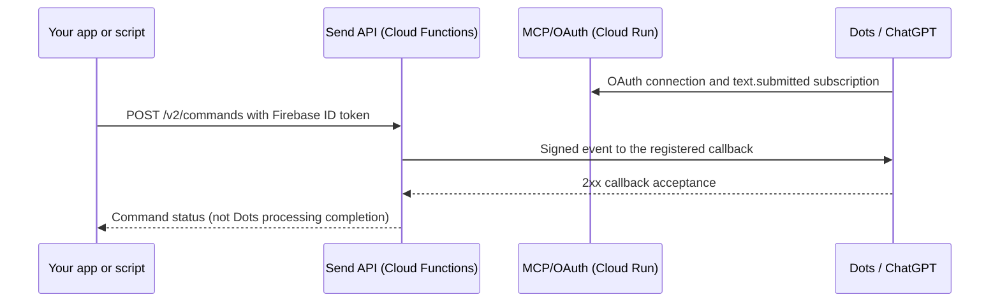

# SendTextToDots

English | [日本語](README_JP.md)

Send text from your own app or script to Dots in ChatGPT, one message at a time, exactly as written.

SendTextToDots is a self-hosted relay. Your authenticated app or script posts text to the API. The service delivers a signed event to the Dots subscription connected by the same user. Dots is the receiving assistant in ChatGPT; its response to the text depends on the instructions you give it there.

> **Status: experimental.** This project uses webhook delivery from the [draft MCP Events proposal](https://github.com/modelcontextprotocol/experimental-ext-triggers-events/blob/main/docs/design-sketch-proposal.md). Changes to the proposal or the receiving service may require updates or break compatibility. This is not an official OpenAI, Apple, or Google product or an endorsed integration.

This is source you deploy yourself, not a hosted service. Detailed documentation in `docs/` is available in English (`*_EN.md`) and Japanese; the web screens are available in English and Japanese.

## How it works

The owner is the user identified by the verified Firebase token. A subscription registers that user's receiving callback and signing secret after OAuth authorization. SendTextToDots delivers text without interpreting it. Direction controls, preset mappings, and text generation belong to the source app; instruction execution belongs to Dots. There is no MCP send tool, message queue, or automatic retry.

## Components

| Component | Runtime | Role |
| --- | --- | --- |
| Send API | Cloud Functions 2nd gen (`sendtexttodotsapi`) | Authenticated text submission, one signed delivery attempt, status lookup, and cancellation |
| MCP/OAuth | Cloud Run (`dist/deployment/connect.js`) | OAuth authorization (interaction pages) and Events subscriptions at `/mcp`. It serves no send screen |
| Local send screen | Your computer (`npm run console`, `dist/console/local-server.js`) | `http://localhost:8765/console`: 5-step setup (Apple login, connection check, test instructions, send, operational instructions) and ordinary sends; relays only the pressed actions to the fixed API/MCP origins with your Bearer token. See [LOCAL_CONSOLE](docs/LOCAL_CONSOLE_EN.md) |
| Storage | Firestore | User connections, OAuth authorizations, subscriptions sealed with KMS, and command status without message text |
| Keys | Cloud KMS and Secret Manager | Sealing keys and separate signing, cookie, identifier, and digest secrets |

See [API](docs/API_EN.md), [configuration](docs/CONFIGURATION_EN.md), and [security design](docs/SECURITY_EN.md) for details.

## Prerequisites

- Node.js 22.23.4 and npm 10.9.9 are the tested local versions. Use a newer patch of the same 22 line (the package declares `>=22.2.0 <23`, the requirement of the APIs used, not a verification of every 22.x); early 22.x releases lack APIs this project uses. See [INSTALL](docs/INSTALL_EN.md) for version limits.
- Your own Google Cloud project with billing enabled and Firebase in the same project, plus Firestore, Cloud KMS, Secret Manager, Cloud Functions, Cloud Build, and Cloud Run resources described in [INSTALL](docs/INSTALL_EN.md).
- Firebase Authentication with the Apple provider, configured through Sign in with Apple and the Apple Developer Program; add the MCP origin's host to authorized domains.
- Access to a receiving Dots/ChatGPT client that supports the required Events subscription. The allowed OAuth client is fixed to the ChatGPT CIMD in `src/oauth/cimd.ts`; arbitrary clients are not supported without source changes.

External service eligibility, agreements, permissions, and costs are your responsibility. This repository does not set an overall spending cap or guarantee operation within a free tier.

## Quick start

1. Install locked dependencies: `npm ci --ignore-scripts --no-audit --no-fund`. `--ignore-scripts` skips package lifecycle scripts during installation; it does not establish that dependencies are safe.
2. Run `npm test`: one build followed by tests using synthetic configuration, synthetic SDKs, and loopback only. Tests do not access real Cloud resources, credentials, or external networks.
3. Follow the ordered [installation guide](docs/INSTALL_EN.md) to choose service URLs, prepare Cloud resources, assign runtime permissions (including `firebaseauth.users.get`), register secrets, and create the KMS subscription marker. Edit the single deployment configuration, `src/config/deployment.ts`, using [CONFIGURATION](docs/CONFIGURATION_EN.md).
4. Run `npm run build`, then `npm run package` to create API ZIP and MCP Cloud Build source archives offline. Packaging does not deploy anything. Repeating unchanged packaging stops with `output_exists`; see [INSTALL](docs/INSTALL_EN.md) for verifying existing archives.
5. Deploy the API to Cloud Functions 2nd gen and the MCP/OAuth service to Cloud Run using the archive deployment examples and origin/IAM checks in [INSTALL](docs/INSTALL_EN.md). These include Functions entry settings and the MCP Dockerfile → Cloud Build → Cloud Run sequence. No provisioning, deployment, or shutdown tool is bundled; the procedure still requires your Cloud permissions and has not been verified end-to-end in a third-party project.
6. Copy `console.config.example.json` to `console.local.json`, fill in your API/MCP origins and public Firebase Web configuration, and run `npm run console -- --config console.local.json`. Open `http://localhost:8765/console` (English and Japanese). Nothing is loaded or sent until you press a button. Follow the 5 steps: sign in with Apple, check the connection (connect the MCP server from Dots/ChatGPT through OAuth and subscribe to `text.submitted` until it shows "Receiving"), paste the test instructions into Dots, send one text and confirm the match in Dots, then paste the operational instructions. See [LOCAL_CONSOLE](docs/LOCAL_CONSOLE_EN.md).
   Only people the operator has explicitly registered with the admin CLI can use the service, including yourself ([CONFIGURATION](docs/CONFIGURATION_EN.md#access-admin)). After the sign-in in step 1, confirm the UID, register it, and then connect.
7. After the setup, use step 4 of the same screen for ordinary sends, or the API example below. "Disconnect" in step 2 revokes the authorization and subscription after a confirmation.

The [Dots receiving and response guide](docs/DOTS_GUIDE_EN.md) provides instructions to paste into your receiving Dots: first for an exact-text delivery check, then for normal replies that quote short messages, summarize long ones, and omit secrets. Both instructions are also available in the send screen's guide, in its selected language.

The distributed configuration is unset (`configured: false`). If built and deployed unchanged, both services stop with a fixed configuration error before SDK creation, credential acquisition, database access, or external HTTP.

## Sending from your app or script

Use the [one-message Node.js example and API contract](docs/API_EN.md#direct-client-example). Supply a current Firebase ID token for the same project and Apple-authenticated user connected to Dots. The example sends one real message per run; keep its commandId to look up an uncertain result.

Firebase ID tokens last about an hour. A sender that uses a Firebase client session should obtain a current token through the SDK; it does not normally require a manual Apple sign-in every hour. The API example consumes a supplied token and does not manage sign-in or refresh. See [sessions and automation limits](docs/API_EN.md#firebase-sessions).

## Compatibility

Version 0.3.0 is for new installations only; there is no automatic migration. The API and Events contract is incompatible with 0.2.0, and versions before 0.2.0 also use different storage, OAuth scopes, and sealing formats. See [compatibility details](docs/INSTALL_EN.md#compatibility-of-030) before deployment.

## Limitations and disclaimer

- The author verified two real Dots deliveries on 2026-10-25 (direct API and `/console`, including Japanese and line breaks), and one simple calculation instruction after restarting the same development environment. These are limited observations, not a guarantee of arbitrary instruction execution.
- A subsequent author-supplied report records setup from GitHub commit `ad276fccc504bc367df209edb694809570496c3e` on a Mac, with deployment configuration changes only, successful builds, and one matching real Dots delivery from `/console`. Mac tests passed 108/112; four failed when binding to `127.0.0.2` (`EADDRNOTAVAIL`). The same source passed 112/112 synthetic tests in Linux Cloud Build. These are author reports, not independent third-party verification or acceptance of long-term production operation. See [LIMITATIONS](docs/LIMITATIONS_EN.md) for environments and remaining limits.
- Production reliability, load, cost, multiple entry points sharing one UID, and immediate processing of each message are not guaranteed. The receiver may batch messages. Draft Events changes may affect compatibility.
- Only users the operator has explicitly registered with the admin CLI can use the service, including yourself. After a stop or re-registration, earlier Grants and subscriptions can no longer be used for new sends or subscriptions; consent through OAuth and subscribe again. Status lookups, cancellation and disconnecting keep working while stopped ([CONFIGURATION](docs/CONFIGURATION_EN.md#access-admin)).
- Authentication supports only Firebase's Apple provider. There is no authentication bypass or arbitrary endpoint, credential, emulator, or HTTP configuration override.
- Message text is not persisted by this service. Expired stored metadata is made unusable, but physical deletion and full account deletion are not implemented. Receiver retention and processing follow that service's terms. Physical erasure from RAM, SDKs, and the OS is not guaranteed.
- MIT licenses this source; it does not sublicense external services or SDKs. See [SECURITY](docs/SECURITY_EN.md) and [LIMITATIONS](docs/LIMITATIONS_EN.md).

## Security

Read the [security policy and reporting channel status](SECURITY.md) and [technical security design](docs/SECURITY_EN.md). The private reporting channel still requires activation and verification at publication. Do not put vulnerability details, tokens, secrets or real user data in public issues.

## Directory layout

| Path | Contents |
| --- | --- |
| `src/config/deployment.ts` | The single deployment configuration file for installers to edit |
| `src/config/validate.ts` | Configuration validation; rejects unset or inconsistent values before side effects |
| `src/deployment/` | Functions entry, Cloud Run entry, and CORS |
| `src/google-runtime/` | Owned Google SDK initialization, Cloud runtime gate, and rejection of unsafe environment variables |
| `src/delivery/`, `src/commands/` | Send API validation, single delivery attempt, cancellation, and status |
| `src/access/` | Access permission (explicit registration by the operator): checks, storage format and the admin CLI core |
| `src/connect/`, `src/oauth/`, `src/mcp/`, `src/events/` | Send screen and OAuth interaction pages (English/Japanese dictionary in `i18n.ts`), OAuth, MCP Events, subscriptions, and signatures |
| `src/storage/`, `src/protection/`, `src/keys/` | Firestore storage formats, KMS sealing, and secret reads |
| `src/egress/` | Safe outbound HTTPS with IP validation, pinned connections, TLS, deadlines, and limits |
| `scripts/` | Offline packaging (`package-artifacts.mjs`), the access admin CLI (`manage-access.mjs`) and test runner |
| `test/` | Automated tests using synthetic values only |
| `references/` | IANA tables used for destination IP classification (CC0 1.0); see [references/README_EN.md](references/README_EN.md) |
| `firestore/` | Deny-all Firestore rules and index exemptions |

## License

[MIT](LICENSE) © 2026 Katsuyasan88. See [THIRD_PARTY_NOTICES_EN.md](THIRD_PARTY_NOTICES_EN.md) ([Japanese](THIRD_PARTY_NOTICES.md)) for third-party packages, SDKs, and reference data.
