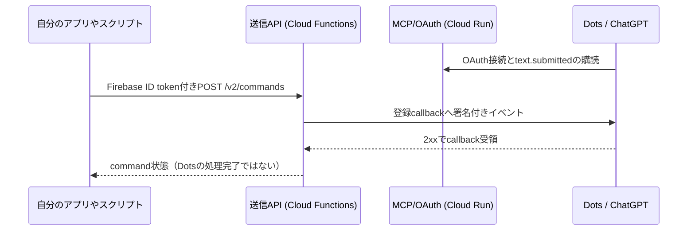

# SendTextToDots

[English](README.md) | 日本語

自分のアプリやスクリプトから、ChatGPTのDotsへ、書いたとおりのテキストを1件ずつ送ります。

SendTextToDotsは自分で配置して使う中継サービスです。認証済みのアプリやスクリプトがAPIへ本文を送り、同じ利用者が接続したDotsの購読先へ署名付きイベントを届けます。DotsはChatGPT側で本文を受け取るアシスタントで、どう応答するかはそこで利用者が与えた指示によります。

> **状態: 実験的。** [MCP Eventsの草案](https://github.com/modelcontextprotocol/experimental-ext-triggers-events/blob/main/docs/design-sketch-proposal.md)のWebhook配送を使っています。草案や受信側サービスの変更により、更新が必要になったり互換性が失われたりする可能性があります。OpenAI・Apple・Googleの公式製品、または承認された連携ではありません。

ホスト済みのサービスではなく、自分で配置するソースです。詳細ドキュメント（`docs/`）は日本語と英語（`*_EN.md`）があり、Web画面も英語/日本語を切り替えられます。

## 今回の変更

- ローカルのoperatorコンソールで発行する、任意の開発者向け6桁コード接続を追加しました。コードは10分以内に1回だけ利用でき、同じ番号は少なくとも24時間再発行しません。新しいコード接続はAppleアカウントと別の利用単位です。機能は既定offです。
- 英語/日本語のコンソールを、ログイン方式の選択と共通の「続ける」に整理しました。コード操作は手順2、必須の受信確認は手順4、固定文の配送テストは手順5、自由文の送信は手順7にあります。
- ほかの手順の右上に控えめな「スキップ」を追加し、同じブラウザに保存されたログインから明示的に再開できるようにしました。既存接続の再開ではコード発行やプラグインの追加し直しは不要です。スキップは確認済みと区別し、送信には受信状態の確認が必要です。
- 画面内の言語切替で、ログイン方式・コード操作・結果メッセージも選択言語に切り替わるよう修正しました。認証のやり直しは発生しません。

詳しくは[ローカル送信画面](docs/LOCAL_CONSOLE.md)と[検証範囲](docs/LIMITATIONS.md)を参照してください。sourceの変更概要で、既存の配置環境を自動更新するものではありません。

## 配送の流れ

ownerは検証済みFirebase tokenで識別する利用者です。購読はOAuth認可後、その利用者の受信先callbackと署名用secretを登録するものです。SendTextToDotsは本文を解釈せず配送します。方向操作・定型指示の割当・本文生成は入力元アプリ、指示の実行はDots側の役割です。MCPの送信tool、キュー、自動再送はありません。

## 構成

| 部分 | 実行先 | 役割 |
| --- | --- | --- |
| 送信API | Cloud Functions 第2世代（`sendtexttodotsapi`） | 認証済み本文の受付、署名付き配送1回、状態照会、中止 |
| MCP/OAuth | Cloud Run（`dist/deployment/connect.js`） | OAuth認可（interaction画面）と`/mcp`でのEvents購読。送信画面は配信しない |
| ローカル送信画面 | 自分のパソコン（`npm run console`、`dist/console/local-server.js`） | `http://localhost:8765/console`。7手順の画面（Appleログイン・プラグイン接続の確認・テスト用指示文・受信状態の確認・固定文の送信テスト・運用用指示文、その後の自由送信）と通常送信。押した操作だけを固定のAPI/MCP originへBearer tokenつきで中継する。[LOCAL_CONSOLE](docs/LOCAL_CONSOLE.md) |
| 保存 | Firestore | 利用者の接続、OAuth認可、KMS封緘した購読、本文を含まないcommand状態 |
| 鍵 | Cloud KMS・Secret Manager | 封緘鍵と、署名・cookie・識別子・digest用に分離した秘密 |

詳細は[API](docs/API.md)・[配置設定](docs/CONFIGURATION.md)・[安全設計](docs/SECURITY.md)を参照してください。

## 前提条件

- ローカルの確認版はNode.js 22.23.4・npm 10.9.9です。同じ22系列の新しいpatchを使ってください（packageの宣言は使用APIに必要な`>=22.2.0 <23`で、全22.xの検証済みではありません）。初期22.xには使用APIがないため、[INSTALL](docs/INSTALL.md)の版の条件を確認してください。
- 請求先が有効な自分のGoogle Cloud projectと、同じprojectのFirebase。[INSTALL](docs/INSTALL.md)記載のFirestore・Cloud KMS・Secret Manager・Cloud Functions・Cloud Build・Cloud Run資源。
- Firebase AuthenticationのApple provider。Sign in with AppleとApple Developer Program側の設定、authorized domainへのMCP originのhostの追加。
- 必要なEvents購読に対応したDots/ChatGPTの利用資格。許可するOAuth clientは`src/oauth/cimd.ts`のChatGPT CIMDに固定され、任意clientにはソース変更なしでは対応しません。

外部サービスの利用資格・契約・権限・費用は導入者の責任です。このリポジトリは全体の費用上限を設定せず、無料枠内での稼働も保証しません。

## 最初の送信まで

1. 固定lockどおりに依存を取得: `npm ci --ignore-scripts --no-audit --no-fund`。`--ignore-scripts`はインストール時のpackage lifecycle scriptを実行しない指定で、依存自体の安全性を保証するものではありません。
2. `npm test`を実行。build1回後、合成設定・合成SDK・loopbackだけで試験します。実Cloud・実資格・外部networkへ接続しません。
3. [導入手順](docs/INSTALL.md)に従い、service URLを決定し、Cloud資源・service account・runtime権限（`firebaseauth.users.get`を含む）・秘密・KMS購読markerを用意。[CONFIGURATION](docs/CONFIGURATION.md)を参照し、唯一の配置設定`src/config/deployment.ts`を編集します。
4. `npm run build`後、`npm run package`でAPI ZIPとMCP Cloud Build source archiveをoffline作成。包装だけでは配置されません。同じ内容での再包装は`output_exists`で停止します。既存archiveの確認方法は[INSTALL](docs/INSTALL.md)を参照してください。
5. [INSTALL](docs/INSTALL.md)のarchive配置例・origin/IAM確認に従い、APIをCloud Functions 第2世代、MCP/OAuthをDockerfile → Cloud Build → Cloud Runの順で配置します。Cloud資源作成・配置・停止のtoolは同梱されません。導入者のCloud権限が必要で、第三者projectでの手順全体の実行検証は未完了です。
6. `console.config.example.json`を`console.local.json`へコピーし、API/MCPのoriginとFirebase Webの公開設定を入れて`npm run console -- --config console.local.json`を実行、`http://localhost:8765/console`を開きます（English/日本語）。ボタンを押すまで読み込みも送信もしません。7段階に沿って、Appleログイン → プラグインの追加と接続許可の確認（Dots/ChatGPTからOAuth接続）→ テスト用指示文をDotsへ貼って受信を開始（`text.submitted`の購読）→ 受信状態の確認（「受信中」）→ 固定文を1件送ってDotsで一致を確認 → 運用用指示文を貼る → 自由な本文を送る、の順に進めます。[LOCAL_CONSOLE](docs/LOCAL_CONSOLE.md)。
   使う本人（自分を含む）は、運営者が管理CLIで明示登録した利用者だけです（[CONFIGURATION](docs/CONFIGURATION.md#access-admin)）。手順1のログイン後にUIDを確認して登録し、それから接続します。
7. セットアップ後は同じ画面の手順7で通常の送信を行うか、下のAPI例を使います。手順2の「接続を解除」は確認の後に認可と購読を失効させます。

[Dotsの受信テストと応答設定](docs/DOTS_GUIDE.md)に、受信先Dotsへ貼る指示文を用意しています。本文一致の配送確認を行った後、短文は引用・長文は要約・秘密情報は省く通常の応答へ切り替えられます。送信画面の案内でも、選択中の言語で両方の文面を表示・コピーできます。

配布設定は未設定（`configured: false`）です。そのままbuild・配置しても、両serviceはSDK生成・資格取得・DB・外部HTTPの前に固定の設定errorで止まります。

## 自分のアプリやスクリプトから送る

[1件送信するNode.js例とAPI契約](docs/API.md#direct-client-example)を使えます。Dotsを接続した利用者と同じproject・Apple認証の有効なFirebase ID tokenを渡します。例は実行するたびに実メッセージを1件送るため、結果不明時の照会に使うcommandIdを控えてください。

Firebase ID tokenの寿命は約1時間です。Firebase clientの認証sessionを使う入力元はSDKで有効なtokenを取得でき、通常は毎時間Appleへ手動で再ログインする必要はありません。API例自体は渡されたtokenを使うだけで、ログインや更新は行いません。[sessionと自動送信の範囲](docs/API.md#firebase-sessions)を参照してください。

## 今後の予定

今後の開発では、次の対応を検討しています。

- **Googleログイン**：Appleに加えるログイン手段。
Googleログインはまだ利用できません。方式・対応順・提供時期は未定で、計画は変更される場合があります。本人確認は既定でFirebaseのApple providerを使い、配置が明示的に有効にした場合だけ開発者向け6桁コード（下記。既定off）も使えます。Appleでの利用には運営者による明示登録も必要です。[現在の認証とsessionの制約](docs/API.md#firebase-sessions)を確認してください。

## 互換性

0.3.0は新規導入専用で、自動移行はありません。API・Eventsは0.2.0と非互換、0.2.0より前とは保存形式・OAuth scope・封緘形式も異なります。配置前に[互換性の詳細](docs/INSTALL.md#030の互換性)を確認してください。

## 制約と免責

- 2026-10-25、作者の環境で実Dotsへの2件の配送（直接APIと`/console`、日本語・改行を含む）と、同じ開発環境の再起動後の単純な計算指示1件を確認しました。限定した確認であり、任意指示の実行保証ではありません。
- 追加の本人提供資料で、MacでGitHubのcommit `ad276fccc504bc367df209edb694809570496c3e` を取得し、配置設定だけを変更してbuildに成功、`/console`からの1件が実Dotsに入力どおり届いた実績を記録しています。Macの自動試験は108/112成功で、4件は`127.0.0.2`へのlisten時の`EADDRNOTAVAIL`で失敗。同じsourceのLinux Cloud Buildでは合成試験112/112成功との報告です。第三者独立検証や長期の本番運用受入とは区別します。環境と残る制約は[LIMITATIONS](docs/LIMITATIONS.md)を参照してください。
- 本番の信頼性・負荷・費用・同UIDの複数入口・1件ごとの即時処理は保証しません。受信側でまとめて処理される場合があります。Events草案の変更も互換性に影響し得ます。
- 使えるのは運営者が管理CLIで明示登録した利用者だけです（自分も含む）。停止・再登録の後は以前のGrant・購読で新しい送信・購読ができず、OAuthの同意と購読のやり直しが必要です。状態の照会・取消・接続解除は停止中も使えます（[CONFIGURATION](docs/CONFIGURATION.md#access-admin)）。
- 本人確認はFirebaseのApple providerと、配置が明示的に有効にした場合（`developerLogin: 'operator-code-v1'`）だけの開発者向け6桁コードの利用単位です。認証省略や任意endpoint・資格・emulator・HTTP経由の設定overrideはありません。
- 本serviceは本文を永続保存しません。期限切れの保存metadataは利用不可になりますが、物理削除とaccount全削除は未実装です。受信後の保持・処理は受信サービスの条件に従います。RAM・SDK・OS内の物理消去も保証しません。
- MITが許諾するのは本sourceで、外部サービスやSDKの利用権を再許諾しません。[SECURITY](docs/SECURITY.md)と[LIMITATIONS](docs/LIMITATIONS.md)を参照してください。

## セキュリティ

[報告方針と受付状態（英語）](SECURITY.md)と[技術的な安全設計](docs/SECURITY.md)を確認してください。脆弱性は報告方針で案内する非公開の受付経路から報告してください。公開issueへ脆弱性の詳細・token・秘密・実データを書かないでください。

## ディレクトリ

| path | 内容 |
| --- | --- |
| `src/config/deployment.ts` | 導入者が編集する唯一の配置設定 |
| `src/config/validate.ts` | 設定の検証（未設定・不整合は副作用の前に拒否） |
| `src/deployment/` | Functions entry・Cloud Run entry・CORS |
| `src/google-runtime/` | Google SDKの所有起動（Cloud実行環境gate・危険な環境変数の拒否） |
| `src/delivery/`・`src/commands/` | 送信APIの入力検証・単回配送・中止・状態 |
| `src/access/` | 利用許可（運営者の明示登録）の判定・保存形式と管理CLIの本体 |
| `src/connect/`・`src/oauth/`・`src/mcp/`・`src/events/` | 送信画面・OAuth interaction画面（英日辞書は`i18n.ts`）・OAuth・MCP Events・購読・署名 |
| `src/storage/`・`src/protection/`・`src/keys/` | Firestore保存形式・KMS封緘・Secret読取り |
| `src/egress/` | 安全なHTTPS送出（IP検証・固定接続・TLS・期限・上限） |
| `scripts/` | offline包装（`package-artifacts.mjs`）・利用許可の管理CLI（`manage-access.mjs`）・試験runner |
| `test/` | 自動試験（合成値だけ） |
| `references/` | 宛先IP分類の根拠にしたIANA表（CC0 1.0）。[references/README.md](references/README.md) |
| `firestore/` | 全拒否のFirestore rulesと索引除外 |

## License

[MIT](LICENSE) © 2026 Katsuyasan88。第三者のpackage・SDK・参照dataは [THIRD_PARTY_NOTICES.md](THIRD_PARTY_NOTICES.md)（[English](THIRD_PARTY_NOTICES_EN.md)）を参照してください。

## 開発者向け6桁コード（任意・既定off）

自分で配置したコンソールのoperator modeでは、Appleの代わりに6桁のコードで接続できます。コードは発行から10分以内に1回だけ使え、同じ番号は少なくとも24時間発行しません。コードごとに新しい利用単位になり、接続後の送信回数は制限しません。詳しくは[ローカル送信画面](docs/LOCAL_CONSOLE.md)・[設定](docs/CONFIGURATION.md)・[セキュリティ](docs/SECURITY.md)を参照してください。
